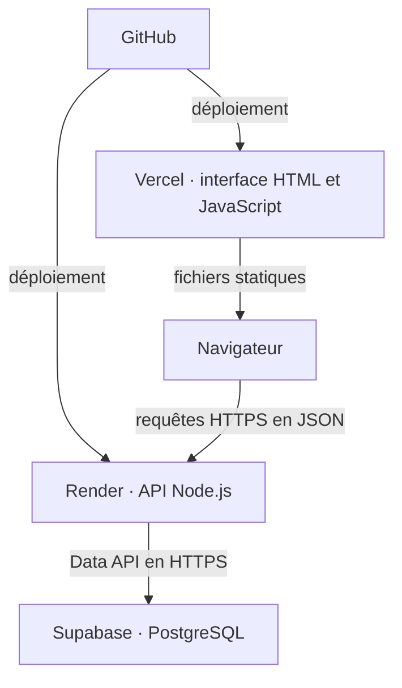

# Suivi des tickets informatiques

Un collaborateur décrit un incident. Le groupe peut ensuite passer le ticket de **Ouvert** à **En cours**, puis à **Résolu**.

## Lancer sur son PC

Installer Node.js 24 puis double-cliquer sur `Lancer.cmd`. Ouvrir http://localhost:8000. Le serveur crée sa base SQLite dans le dossier backend. Fermer la console arrête le serveur. Relancer le fichier permet de retrouver les tickets.

## Architecture de production

## Mise en ligne

1. Dans un projet Supabase dédié, activer la Data API et exécuter une fois `backend/schema.sql` dans SQL Editor. Le SQL crée la table, contrôle les statuts et réserve l’accès direct au serveur.
2. Sur Render, créer un Web Service Node lié à la branche main. Dossier racine `backend`, build `node --check serveur.mjs`, démarrage `npm start`, chemin de santé `/health`. Choisir une instance gratuite.
3. Sur Render, renseigner `SUPABASE_URL` avec l’URL du projet, `SUPABASE_SECRET_KEY` avec sa clé serveur de type sb_secret et `FRONTEND_ORIGIN` avec l’origine HTTPS exacte du frontend, sans slash final. Render fournit le port.
4. Sur Vercel, importer le même dépôt avec le dossier racine `frontend`. Définir `API_URL` avec l’origine HTTPS de Render. Le fichier vercel.json lance le build et publie le dossier dist. Vérifier que FRONTEND_ORIGIN correspond au domaine effectivement attribué.
5. Ouvrir le site, créer un ticket et changer son statut. Actualiser puis redémarrer l’API et vérifier le même numéro de ticket. Pour la démonstration du redéploiement, modifier le titre dans index.html, faire un commit et un push sur main. Comparer le commit déployé sur Vercel et le titre public.

## Routes

| Méthode | Chemin | Résultat |
| --- | --- | --- |
| GET | /health | 200 si le serveur répond |
| GET | /api/tickets | 200 et liste des tickets |
| POST | /api/tickets | 201 et ticket créé à partir de titre et description |
| PATCH | /api/tickets/:id | 200 et ticket mis à jour à partir de statut |

Un champ vide ou un statut inconnu donne une réponse 400. Un numéro de ticket inexistant donne 404. Cette application de démonstration permet à tous les visiteurs de consulter et modifier les tickets. Utiliser des incidents fictifs.

## Compte rendu technique

Vercel distribue les fichiers statiques. Render exécute le code qui valide le formulaire. Supabase conserve les lignes même quand le serveur redémarre. Seul Render reçoit la clé de la base. Le contrôle d’origine permet au navigateur d’appeler l’API depuis le domaine du site.

Pendant la mise en place, Render a demandé la validation du compte par e-mail. Le tableau de bord a été rouvert après cette étape pour reprendre la connexion.

## Démonstration orale (3 à 5 minutes)

- **0:00 à 1:00** — Montrer le schéma. Suivre le trajet du bouton « Créer le ticket » jusqu’à PostgreSQL.
- **1:00 à 2:00** — Ouvrir le site, déclarer « Imprimante en salle 213 » et décrire le problème. Montrer le numéro obtenu et le statut Ouvert.
- **2:00 à 3:00** — Passer le ticket à En cours puis à Résolu. Actualiser et retrouver son numéro. Comparer avec la réponse JSON de GET /api/tickets.
- **3:00 à 4:00** — Montrer le dernier déploiement et son commit. Chaque membre explique une opération qu’il a réellement effectuée.

## Vérifications du 19 novembre

Le dépôt privé est sur https://github.com/Nyhrox1737/tp-tickets-ynov. L’API publique est accessible sur https://tp-tickets-ynov.onrender.com/api/tickets. Elle a retourné une liste vide après la création de la table sur Supabase. En local, un ticket passé à Résolu a gardé son statut après ouverture de la base par un deuxième processus Node. La route /health affiche le nom de l’application pour repérer le second déploiement Render.
